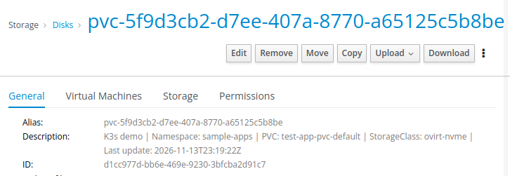

# Sync PVC description disks in Ovirt/OLVM


## Information
Simple controller for __Ovirt-CSI__. This controller gets all PVC/PV, connect to Ovirt api and fill descriptions about created PVC.

I'm not go programmer so yes, entire go code and charts was generated by AI with manual fix, but seems it's works and fill virtual disks in Ovirt/OLVM with additional description to easy identify what is what.

It should use existing secrets and configmap from ovirtcsi, but not all options were tested.

## Example description



## Example install

### 1. Create a `values.yaml` file with your configuration:

```yaml
deploymentName: "ovirt-pvc-description-prod"
namespace: "ovirt-csi-system"

env:
  resyncInterval: "5m"
  descriptionPrefix: "k3-pvc-mycluster"

credentialsSecret:
  name: "ovirt-csi-creds-prod"

caConfigMap:
  name: "ovirt-csi-ca-prod.crt"

# Optional: run on control-plane nodes
nodeSelector:
  node-role.kubernetes.io/control-plane: "true"

tolerations:
  - key: node-role.kubernetes.io/control-plane
    operator: Exists
```

### 2. Install the chart from GHCR:

```bash
helm install ovirt-pvc-description oci://ghcr.io/luksiol/ovirt-pvc-description/charts/ovirt-pvc-description \
  --version <version> \
  --namespace ovirt-csi-system \
  --create-namespace \
  -f values.yaml
```